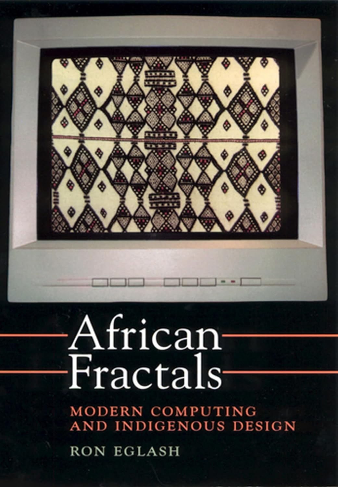

---



```{r}
#| label: setup
#| include: false
library(tidyverse)
library(ggdiagram)

```

## Introduction

Topics that may be covered here:\

- Iterated Function Systems and Fractals\
- Symmetries in Space\
- L Systems, Mandalas and Kolams\
- Logistic Functions\
- Projections\

##  Inspiration

This equation will change how you see the world.  It's about the Logistic Map, bifurcation diagrams, the Mandelbrot set, animal populations, dripping faucets, neuron firing rates and more.

::: {}
<center>

The Logistic Equation
</center>
:::

So let us see how we can construct this algorithmically, the different parts of it. And of course why we should bother!

## What is an Iterated Function?

Well, we know what a `function` is don't we? A relationship between numbers. One varies as the others, and the relationship is specified by the function. E.g. $y = \sin(x)$.

So what is `iteration` then, and how do you do that to a function? It is applying the same function over and over again, by piping the results of the previous step i.e. iteration back into the function. Let us hear from Ron Eglash, the author of *African Fractals: Modern Computing and Indigenous Design*


```{r}
#| echo: false
#| out-width: "320px"
#| out-height: "480px"
#| fig-align: center


```
Let us go off to [TED](https://www.ted.com/talks/ron_eglash_the_fractals_at_the_heart_of_african_designs?utm_campaign=tedspread&utm_medium=referral&utm_source=tedcomshare) and hear from Ron Eglash, the author of *African Fractals: Modern Computing and Indigenous Design*.

## Some Examples of Iterated Functions

## A concrete example

Let $f$ be the `map`:

$$
f(x,y)=(x^2-y^2,\;2xy).
$$

This is the complex squaring `map`: if \(z=x+iy\), then \(f(x,y)\) represents \(z^2\). Let \(g\) be rotation by 120 degrees, a symmetry of an equilateral triangle. Then \(f\) commutes with \(g\): rotating a point before squaring it produces the same point as squaring it and then rotating.

## R code

```{r}
# A 2D point

x <- c(1, 0)

# f(x, y) = (x^2 - y^2, 2xy)
# This is equivalent to squaring the complex number x + iy
f <- function(p) {
  a <- p[1]
  b <- p[2]
  c(a^2 - b^2, 2 * a * b)
}

# Rotate a point by 120 degrees counterclockwise
rotate_120 <- function(p) {
  theta <- 120 * pi / 180
  R <- matrix(c(cos(theta), -sin(theta),
                sin(theta),  cos(theta)),
              nrow = 2, byrow = TRUE)
  R %*% p
}

# Left side: f(gx)
left <- f(rotate_120(x))

# Right side: g(fx)
right <- rotate_120(f(x))

left
right

# Check that they agree
all.equal(as.vector(left), as.vector(right))

```

Expected result:

```r
 [en.wikipedia](https://en.wikipedia.org/wiki/Function_composition) -0.5 -0.8660254
 [en.wikipedia](https://en.wikipedia.org/wiki/Function_composition) -0.5 -0.8660254
 [en.wikipedia](https://en.wikipedia.org/wiki/Function_composition) TRUE
```

A simple way to see \(f(gx)=g(fx)\) is: **rotate the input first, then apply \(f\)** gives the same result as **apply \(f\) first, then rotate the output**. In other words, \(f\) treats every symmetric direction in the same way. Function composition \(f(g(x))\) means “apply \(g\), then \(f\).” [en.wikipedia](https://en.wikipedia.org/wiki/Function_composition)

## What the result means

Starting with \(x=(1,0)\):

- Rotate it by 120 degrees, then apply \(f\): \(f(gx)\).
- Apply \(f\), then rotate the result by 120 degrees: \(g(fx)\).

Both routes give approximately \((-0.5,-0.866)\). Therefore,

\[
f(gx)=g(fx).
\]

This is what “\(f\) commutes with \(g\)” means. The map \(f\) does not favor one of the three 120-degree-symmetric directions over another; it preserves the symmetry. [en.wikipedia](https://en.wikipedia.org/wiki/Function_composition)

## Connection to the paper

In the paper, \(\Gamma\) is a whole collection of such symmetry operations—for example, rotations by 0, 120, and 240 degrees. If \(f(gx)=g(fx)\) holds for every \(g\) in that collection, then any attractor generated by repeatedly applying \(f\) can inherit the same symmetry: rotating the final chaotic picture by 120 degrees leaves it unchanged. 

One caution: this does **not** mean that \(g\) and \(f\) are interchangeable as functions in every setting. It means specifically that, for this \(f\) and this symmetry \(g\), the order of “rotate” and “apply \(f\)” does not matter. [en.wikipedia](https://en.wikipedia.org/wiki/Function_composition)


##  Wait, But Why?


##  References
1.

1.


