```{r}
#| label: setup
#| echo: false
# install.packages("devtools")
# devtools::install_github("hadley/emo")
library(emo)

```


## Inspiration

Look at this fabric map of Africa: 
<center>
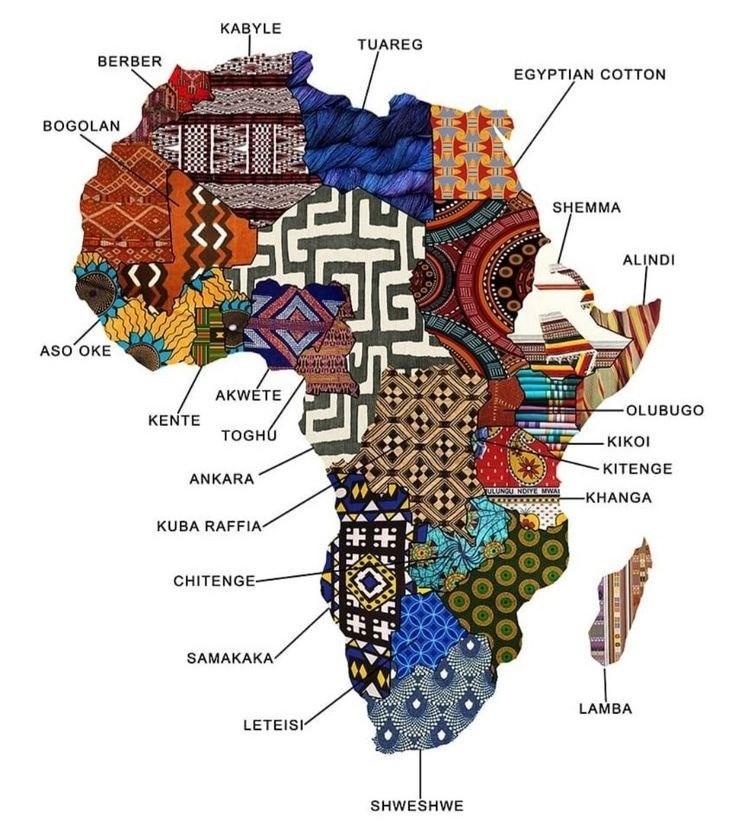{#fig-africa-textile}
</center>


And look at this map of Nobel prize winners!

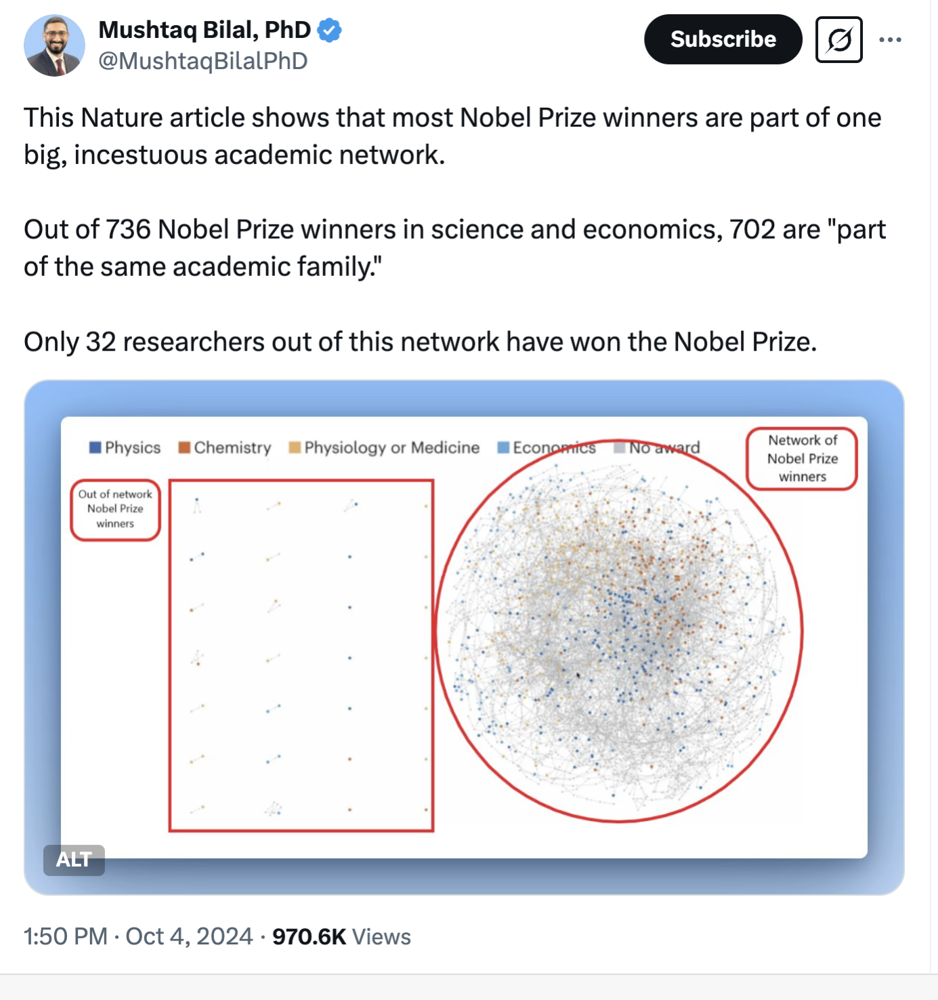{#fig-nobel-winners}

Would there be anything in common between these two `r emo::ji("open_mouth")` ??!! How???!!!

## Introduction

The South Indian tradition of Kolam, and the [Angolan tradition of Lusona](https://www.sahistory.org.za/sites/default/files/archive-files3/paulus_gerdes_lunda_geometry_mirror_curves_desbook4you.pdf) art have quite a few things in common. Both are also strongly linked to finite grammars and networks.

##  Inspiration

<center>
<iframe src="https://openprocessing.org/sketch/296103/embed/" width="780" height="780">
</iframe><br>
Click to generate a fresh Kolam!
</center>


## Creating Kolams

How do we create these Kolam Patterns? Let us do this two ways: first
pretending we are a South-Indian Woman adorning her doorstep in the
morning. And then with two other methods, that lend themselves to
computation / iteration. So, first by hand!

### Method #1: By Hand!

See if you can manually mimic some of the moves here! As an exercise,
try to ***anchor your elbow and forearm to the table***, and draw the
pattern by rotating the paper! What are your observations?

::: {layout-ncol=3}

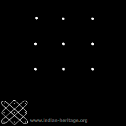


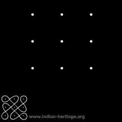


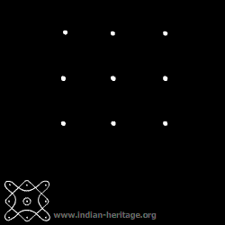


:::
::: {layout-ncol=3}


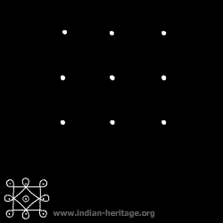

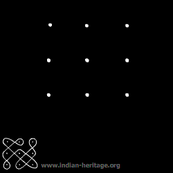


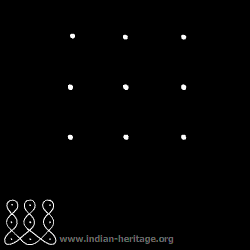

:::
::: {layout-ncol=3}

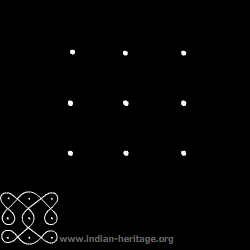

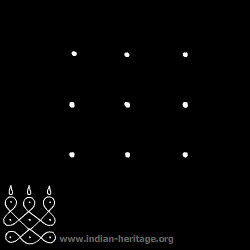

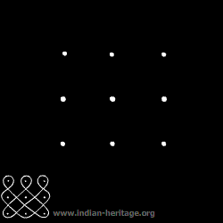

:::


### Method #2: Using **Canonical Pieces**

What does **canonical piece** mean? These are pieces like the alphabet: pieces that can be repeatedly used to create a vast variety of patterns? Sounds familiar again?

Check the Polypad: <https://polypad.amplify.com/p#patterns>

:::{}
<center>
<iframe width="720" height="540" src="https://polypad.amplify.com/embed/rCq5kCTD1IYtg" frameborder="1" allowfullscreen></iframe>
</center>
:::

Here we use "pieces of Kolam" that are standard: by repeated usage of combinations of these pieces, ( I believe ) any kolam can be produced. Here is a video showing kolams with a few **canonical pieces**:

:::{}
<center>

Using "Canonical Pieces" by Saty Raghavachary
</center>
:::

Which are the canonical pieces here?

This is also the idea embedded in this toy called [Kolam
Tiles](https://kolamtiles.com/). See this [YT Playlist on Kolam Tiles](https://youtube.com/playlist?list=PL6LYOn0Nvs_spbp4kYo2llyTmwPbFdEUf&si=ThsBwebTaEYInKNr).

This program called Forkphorus <https://forkphorus.github.io/app.html?id=429945831> gives a point-and-click interface to place canonical kolam tiles to achieve a design. 

::: {.content-hidden}

::: {layout-ncol=2}

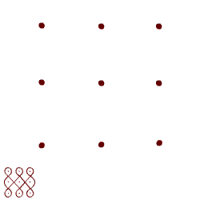

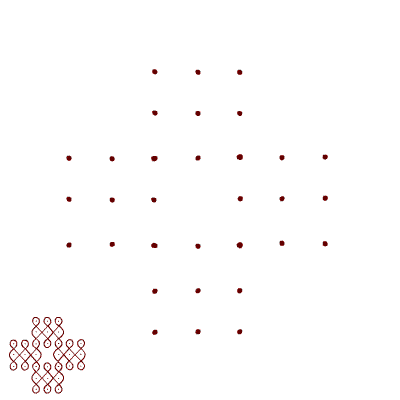

:::

::: {layout-ncol=2}

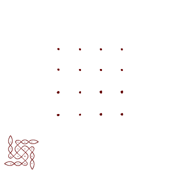

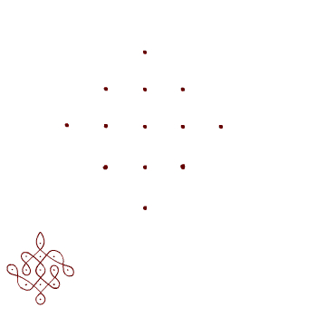

:::

::: {layout-ncol=2}

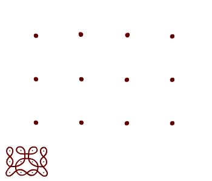

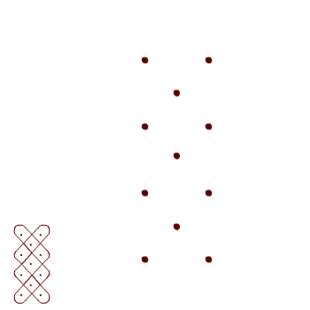

:::
:::

This very accessible paper by Nagata and Thamburaj illustrates this concept and may help in recreating this idea digitally, in `p5.js`!



### Method #2: Using Mirrors and Light

This follows the development of [Paul
Gerdes](https://www.mi.sanu.ac.rs/vismath/paulus/index.html). 



First let us get a printable grid to make our Kolams manually, since
making grids can become tedious when you are making a lot of Kolams. We
can use the grid to place "pulli-s" on the grid to make our Kolam. Head
off to: <https://editor.p5js.org/arvindv/sketches/UuHApkvqd> and open it
in your p5.js web-editor. Print out a few samples of the `.svg` grid
file that is generated.

Now consider that each of your Kolam "lines" or "trajectories" is [made
of light](https://www.imaginary.org/program/frozenlight). And place some
single horizontal or vertical mirrors, at some locations *midway between
adjacent pulli-s*. See the figure below:

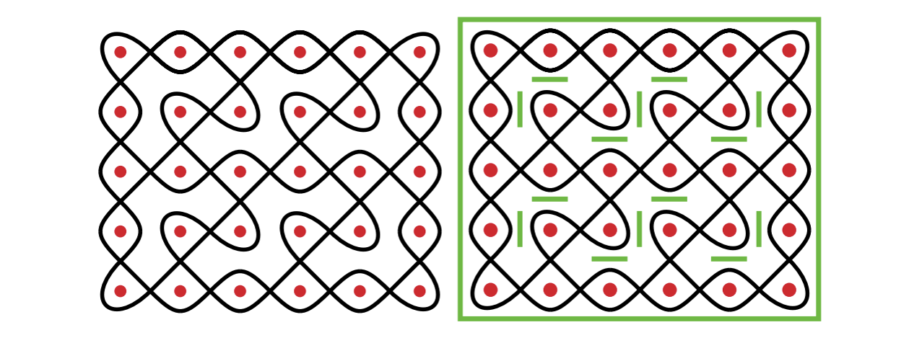{#fig-kolam-with-mirrors}

The black lines here are to be imagined as *"made of light"*. Whenever
they hit a mirror, a *"curved reflection"* occurs. Note how the
arrangement of mirrors is symmetric here. Can we take *computational
liberties* here and make asymmetric mirror arrangements? Can the grid
also be non-square? Try?


## The Mathematics of Kolam

We will follow the *Lunda Geometry* treatment of Gerdes here, and also briefly( Ha! Briefly!!) touch upon the S. Jablan's treatment based on *Knot Theory*. 

TBWU. 

 - Combine Karnaugh Maps, Network Adjacency Matrics, Cayley Symmetry Matrices, and Paulus Gerdus' Modulo-m Lunda matrices into a unified "Kolam Symmetry Matrix". 
 - Discuss the similarity to Wang tiles.
 
 Questions:
 - Can we generate random KSMs and find "symmetry on average", in the manner of Field and Golubitsky?
 - Can we mimic Kolam Tiles / Saty Raghavachary's video in code?
 - How "simple" can the code be?
 
 
### Basics of Lunda Geometry and Kolam

For more inspiration, see
[here](https://www.mi.sanu.ac.rs/vismath/paulus/pg1.htm). This is a multipage article with many different grid+mirror arrangements! There is also an intriguing technique shown therein of **colouring the squares in the grid** alternatively white and black, to generate very symmetric shaded patterns!

### Kolams and Knot Theory
S. Jablan's treatment based on *Knot Theory*

## Kolams with Code

Work in (slow....) Progress!!!

::: {.panel-tabset .nav-pills style="background: whitesmoke;"}


### Using p5.js

```{=html}
<div id="sona-sketch"></div>

<script src="https://cdnjs.cloudflare.com/ajax/libs/p5.js/1.9.0/p5.min.js"></script>
<script>
// Self-contained p5.js sketch in instance mode
// so it embeds cleanly inside a Quarto HTML document.

const sonaSketch = (p) => {
  // ========== STEP 1: Canonical pieces ==========
  const pieces = {
    straight_h: { pts: [[0, 0.5], [1, 0.5]] },
    straight_v: { pts: [[0.5, 0], [0.5, 1]] },
    turn_ne:    { pts: [[0.5, 1], [1, 0.5]] },
    turn_nw:    { pts: [[0, 0.5], [0.5, 1]] },
    turn_se:    { pts: [[1, 0.5], [0.5, 0]] },
    turn_sw:    { pts: [[0, 0.5], [0.5, 0]] },
    bounce_h:   { pts: [[0, 0.5], [0.5, 0.3], [1, 0.5]] },
    bounce_v:   { pts: [[0.5, 0], [0.3, 0.5], [0.5, 1]] }
  };
  const pieceNames = Object.keys(pieces);

  // ========== STEP 2: Sampling & aligning ==========
  const m = 6;          // rows
  const n = 8;          // columns
  const cell = 50;      // pixel size of each cell
  let grid = [];

  p.setup = () => {
    const cnv = p.createCanvas(n * cell, m * cell);
    cnv.parent("sona-sketch");   // attach to the div above

    // sample a piece for every cell
    for (let i = 0; i < n; i++) {
      grid[i] = [];
      for (let j = 0; j < m; j++) {
        grid[i][j] = p.random(pieceNames);
      }
    }
    p.noLoop();
  };

  p.draw = () => {
    p.background(252);

    // reference dots (classic sona/Kolam points)
    p.fill(90);
    p.noStroke();
    for (let i = 0; i < n; i++) {
      for (let j = 0; j < m; j++) {
        p.circle((i + 0.5) * cell, p.height - (j + 0.5) * cell, 6);
      }
    }

    // draw the randomly sampled pieces
    p.stroke(50, 110, 180);
    p.strokeWeight(3);
    p.noFill();
    for (let i = 0; i < n; i++) {
      for (let j = 0; j < m; j++) {
        const piece = pieces[grid[i][j]];
        p.beginShape();
        for (const pt of piece.pts) {
          const px = (i + pt[0]) * cell;
          const py = p.height - (j + pt[1]) * cell;
          p.vertex(px, py);
        }
        p.endShape();
      }
    }
  };
};

// launch the sketch
new p5(sonaSketch);
</script>
```


### Using R

```{r}
library(ggplot2)
library(dplyr)

# ========== STEP 1: Canonical pieces ==========
# Each piece is a list of line segments inside the unit square [0,1]×[0,1]
# Ports: which sides it connects (N=1, E=2, S=3, W=4)

pieces <- list(
  straight_h = list(segs = data.frame(x=c(0,1), y=c(0.5,0.5)), ports=c(2,4)),
  straight_v = list(segs = data.frame(x=c(0.5,0.5), y=c(0,1)), ports=c(1,3)),
  turn_ne    = list(segs = data.frame(x=c(0.5,1), y=c(1,0.5)), ports=c(1,2)),
  turn_nw    = list(segs = data.frame(x=c(0,0.5), y=c(0.5,1)), ports=c(1,4)),
  turn_se    = list(segs = data.frame(x=c(0.5,1), y=c(0,0.5)), ports=c(2,3)),
  turn_sw    = list(segs = data.frame(x=c(0,0.5), y=c(0.5,0)), ports=c(3,4)),
  bounce_h   = list(segs = data.frame(x=c(0,0.5,1), y=c(0.5,0.3,0.5)), ports=c(2,4)), # mirror-like
  bounce_v   = list(segs = data.frame(x=c(0.5,0.3,0.5), y=c(0,0.5,1)), ports=c(1,3))
)

piece_names <- names(pieces)

# ========== STEP 2: Sampling & aligning ==========
m <- 6; n <- 8; set.seed(123)

# sample a piece for every cell
grid <- expand.grid(i = 1:n, j = 1:m) %>%
  mutate(piece = sample(piece_names, n(), replace = TRUE))

# expand into drawable segments, translated to cell position
draw_data <- grid %>%
  rowwise() %>%
  do({
    p <- pieces[[.$piece]]
    data.frame(
      i = .$i, j = .$j,
      x = p$segs$x + .$i - 1,
      y = p$segs$y + .$j - 1,
      group = paste(.$i, .$j, sep = "_")
    )
  }) %>% ungroup()

# optional: dots at cell centres (classic sona reference points)
dots <- expand.grid(x = 0.5:(n-0.5), y = 0.5:(m-0.5))

# plot
ggplot() +
  geom_point(data = dots, aes(x, y), colour = "grey50", size = 2) +
  geom_path(data = draw_data, aes(x, y, group = group),
            colour = "steelblue", linewidth = 1.2) +
  coord_fixed() +
  theme_void() +
  labs(title = "Randomly sampled canonical pieces → sona/Kolam attempt")

```

:::


##  Wait, But Why?

Kolams and Sona are powerful metaphors for [graphs and networks](../../../../Analytics/Descriptive/Modules/100-Networks/index.qmd). These ideas show up in a variety of situations, such as tranportation networks, supply-chain, friendship networks, tracing literary and artistic influence, and so on. 

##  References

1. Jurgen Koller. *Kolams and Sona*. <https://mathematische-basteleien.de/kolams.htm>
1. Syamala Chenulu. *Teaching Mathematics through the ART OF KOLAM*
1.  Mirror Designs and Mirror Curves: Comparing Kolam and Tchokwe Art. <https://www.mi.sanu.ac.rs/vismath/paulus/pg1.htm>
1.  YANAGISAWA, Kiwamu & Nagata, Shojiro. (2007). *Fundamental Study on Design System of Kolam Pattern*. <https://www.researchgate.net/publication/237442288_Fundamental_Study_on_Design_System_of_Kolam_Pattern>
1. Paulus Gerdes. *Lunda Geometry: Mirror Curves, Designs, Knots, Polyominoes, Patterns, Symmetries*.

1. Visual Mathematics. Mathematical Institute of the Serbian Academy of Sciences and Arts. Editor: Ljiljana Radovic. ISSN: 1821-1437. <https://www.mi.sanu.ac.rs/vismath/>
1.  Anu Reddy and Alex McLean.(March 2024). *Drawing Kolam Patterns in Stitches and Code*. <https://alpaca.pubpub.org/pub/eljjyi80/release/6>
1. Labs Without Borders on Medium. (Nov 29, 2020). *Folkloric Graph Theory: The Mathematics of Kolam.* <https://liubauer.medium.com/mathematics-of-kolam-folkloric-graph-theory-4b3acc79d5cb> 


## Additional Reading

1. Symmetry Journal. <https://www.mdpi.com/journal/symmetry> [ Open Access]
1. Some kolam like patterns for inspiration. <https://www.pinterest.com/gbenainous/p5js-teaching-ideas/>
1.  Dr. Gift Siromoney's webpage. <https://www.cmi.ac.in/gift/Kolam.htm>
1.  Imaginary.Org. *Frozen Light App*.
    <https://www.imaginary.org/program/frozenlight>
1.  <https://kolamtiles.com>
1.  <https://algorithmicpattern.org>
1.  Ascher, M. (2002). *The Kolam Tradition: A tradition of
    figure-drawing in southern India expresses mathematical ideas and
    has attracted the attention of computer science*. American
    Scientist, 90(1), 56+. <https://www.jstor.org/stable/27857597>
