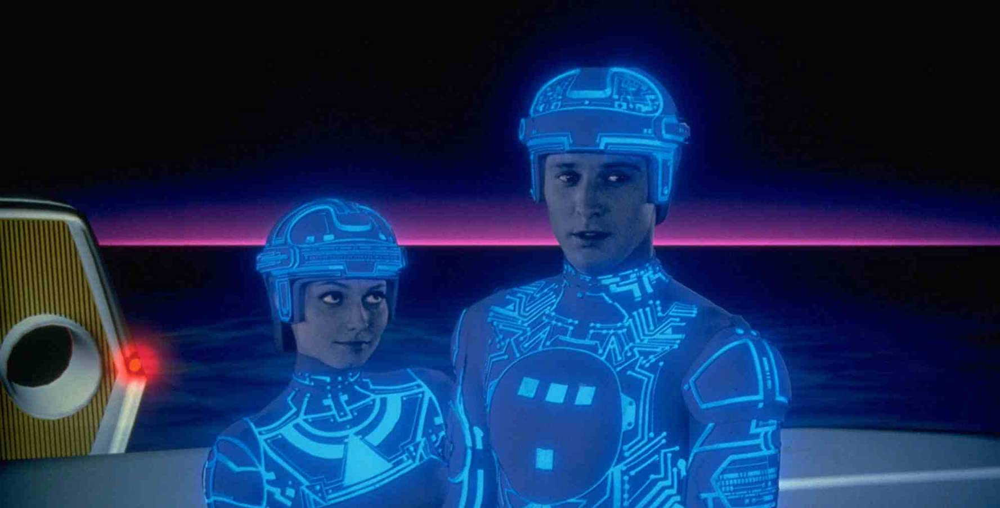
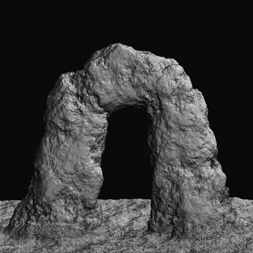
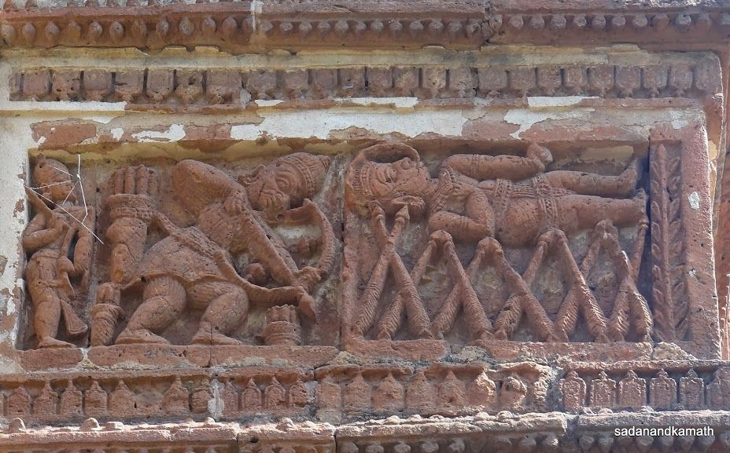



```{r setup, include=FALSE}
#library(blogdown)
library(tidyverse)
library(ggformula)
# library(ggcube) # New package for 3D plots (May2026)
# library(ggpointless) # fancy extra geoms for better diagrams
# library(ggdiagram) # What is says

library(ambient) # Noise generation in R
library(plotly)
#library(plot3D) # 3D plots for explanation
#library(rgl) # Interactive 3D plots for explanation
#options(rgl.useNULL = TRUE)
#knitr::knit_hooks$set(webgl = hook_webgl)
#library(caracas)
library(downloadthis)
library(knitr)
library(kableExtra)
## Markdown boiler plate stuff!!
# {#fig-elephant}
# This is illustrated well by @fig-elephant.
# 
# ### Figure Panel Divs
#     ::: {#fig-elephants layout-ncol=2}
#     {#fig-surus}
#     {#fig-hanno}
#      Famous Elephants
#     :::
#     Adding download buttons
#     data that has been read in
#     
#    existing file
#     

```

---
```{r}
#| label: fig-tron-the-movie
#| echo: FALSE
#| fig-cap: "TRON the Movie"
#| fig.align: 'center'
#| out-width: "75%"
#| out-height: "75%"
#| 


```

##  What noise based outcomes will we see today?

We will understand the basics of *procedural noise generation*:
generating random noise-like numbers that allow us to model and create
very realistic-looking textures, such as wood, fire, marble, terrain,
mountains, and clouds.

##  Inspiration

::: {#fig-perlin layout-ncol="2"}



Perlin Noise based Textures
:::

##  What is Perlin Noise?

Ok, this is going to be a long explanation!!!

#### A. The Bed of Arrows

Let us take some inspiration from the Mahabharata first: Here is an evocative picture of an event from the great epic, where Bheeshma is lying on a bed of arrows, and the arrows are piercing his body in random directions. The arrows are like the gradient vectors in Perlin Noise, and the point of interest is like Bheeshma's body. 


```{r}
#| label: fig-bheeshma
#| echo: FALSE
#| fig-cap: "Bheeshma On a Bed of Arrows"
#| fig.align: 'center'
#| out-width: "75%"
#| out-height: "75%"
#| 


```

Let us start by dividing up 2D space ( for now!!) into square-shaped
cells. At each vertex we place a **[unit gradient
vector]{.purple}** labelled $\pmb{\color{purple}{r_{i}}}$ that points in a random direction.


#### B. The Four Dot Products


See the figure below:

<center>
<iframe width="680px" height="500px"
src="https://editor.p5js.org/arvindv/full/J4djkb9_n">
</iframe>
</center>

We wish to calculate the Perlin Noise amount at [any point of
interest]{.green} inside the cell.

-   We draw [difference vectors to the point]{.red} from each of the 4
    vertices.
-   We compute the [**vector dot product**](https://www.youtube.com/watch?v=DHPfoqiE4yQ&pp=ygUaaW5uZXIgcHJvZHVjdCBjb2RpbmcgdHJhaW4%3D)
    with each of the $\pmb{\color{purple}{r_{i}}}$ and the above difference vectors. ( 4 dot products )
-   These are shown in the text print at the side of the figure.

::: callout-note
### [Dot Products](https://www.math.hkust.edu.hk/~machas/vector-calculus-for-engineers.pdf) are Scalars with Polarity

Note how the 4 dot products change as you move the mouse/touchpad. This
changes the location of the POI and hence the scalar dot products change
in amplitude **and** polarity.

In a typical Perlin Noise implementation, the gradient vectors are
**fixed** after an initial setup. 
:::

#### C. Weighted Combining of Dot Product values

With the ***4 scalar dot products***, we are now ready to compute the Perlin Noise value at the point of interest. There are several ways of doing this:

-   Simply take their average.
-   Take a **weighted** average, with fixed weights.
-   Use a *weighting/interpolating function*: The closer a point of
    interest is to one or other of the cell vertices, the higher is the
    contribution of the corresponding dot-product.

The third approach is the one embedded within (all?) Perlin Noise
implementations. The interpolating function is:

$$
f(t) = 6t^5-15t^4+10t^3
$$ {#eq-interpolation-function}

and looks like this Darth Vader cape, one from each vertex :

```{r}
#| label: fig-interpolating-function
#| fig-cap: :Interpolating Function for Perlin Noise
#| echo: false
#| out-width: "75%"
#| out-height: "75%"

## Unit Square Surface
gf_polygon(c(0,0.25, 0.25,0) ~ c(0,0.25, 0.75,1), 
           fill = "grey90", colour = "black") %>% 
## Interpolating function from V(0,0)
  gf_fun(6*(1-x)^5 - 15 * (1-x)^4 + 10* (1-x)^3 ~ x, 
       xlim = c(0, 1), linetype = "dashed") %>% 
## Vertices
  gf_point(c(0,0.25, 0.25,0) ~ c(0,0.25, 0.75,1), size = 3,, 
       title = "Interpolating Function", 
       subtitle = "Used from each vertex of a unit square area",
       ylab = "Dot Product Weighting\n from Vertex(0,0)") %>% 
## Reference vertical at (0,0)
  gf_segment(1 + 0 ~ 0 + 0) |> 
  
## Gradient Vectors
  gf_segment(0 + 0.125 ~ 0 + 0.2,  
             arrow = arrow(ends = "last", angle = 10),
             colour = ~"Gradient1",linewidth = 1) %>% 
  gf_segment(0 + 0.125 ~ 1 + 0.75, 
             arrow = arrow(ends = "last", angle = 10),
             colour = ~"Gradient2", linewidth = 1) %>% 
  gf_segment(0.25 + 0.5 ~ 0.25 + 0.1,  
             arrow = arrow(ends = "last", angle = 10),
             colour = ~"Gradient3",linewidth = 1) %>% 
  gf_segment(0.25 + 0.65 ~ 0.75 + 1.0, 
             arrow = arrow(ends = "last", angle = 10),
             colour = ~"Gradient4", linewidth = 1) %>% 
  
  ## Tilted Y-axis
  gf_segment(0 + 0.35 ~ 0 + 0.35, 
             #arrow = arrow(ends = "last", angle = 10), 
             colour = "black", linewidth = 0.1) %>%
  
## Difference Vectors to POI
  gf_segment(0 + 0.125 ~ 0 + 0.35,  
             arrow = arrow(ends = "last", angle = 10),
             colour = "grey40",linewidth = 1) %>% 
  gf_segment(0 + 0.125 ~ 1 + 0.35,  
             arrow = arrow(ends = "last", angle = 10),
             colour = "grey40",linewidth = 1) %>% 
## Point of Interest
  gf_point(0.125 ~ 0.35, size = 4, colour = ~ "Point of Interest") %>% 
  ## X-axis
    gf_segment(0 + 0 ~ 0 + 1.25, 
               #arrow = arrow(ends = "last", angle = 10), 
               colour = "black", linewidth = 0.1) %>%
  ## Labels
  gf_refine(annotate(geom = "text", label = "Vertex(0,0)", 
                     x = 0.1, y = -0.05,size = 3)) %>% 
  gf_refine(annotate(geom = "text", 
                     label = "Vertex(1,0)", 
                     x = 1.05, y = -0.05, size = 3)) %>%
  gf_refine(annotate(geom = "text", 
                     label = "Vertex(0,1)", 
                     x = 0.125, y = 0.25, size = 3)) %>% 
  gf_refine(annotate(geom = "text", 
                     label = "Vertex(1,1)", 
                     x = 0.875, y = 0.25, size = 3)) %>% 
  gf_refine(annotate(geom = "text", 
                     label = "Point of Interest", 
                     x = 0.375, y = 0.175, size = 2)) %>% 
  #gf_refine(coord_fixed()) %>% 
  gf_theme(theme = theme(axis.line = element_blank(),
                         axis.ticks = element_blank(),
                         panel.grid = element_blank(),
                         legend.title = element_blank(),
                         axis.title.x = element_blank(),
                         axis.text.x = element_blank(), 
                         legend.position = "bottom"))

```

```{r}
#| label: fig-3D-interpolation-plot
#| echo: false
#| eval: false

my_points <- tibble(
  x = c(0, 0, 1, 1, 0.6),
  y = c(0, 1, 0, 1, 0.2),
  z = c(0, 0, 0, 0, 0)
)
my_gradient <- tibble(x = c(0, 0.5),
                      y = c(0, -0.2),
                      z = c(0, 0.6))
my_vector <- tibble(x = c(0, 0.6),
                    y = c(0, 0.2),
                    z = c(0, 0))

mosaicCalc::interactive_plot(6*(1-x)^5*(1-y)^5 - 15 * (1-x)^4*(1-y)^4 + 10* (1-x)^3*(1-y)^3 ~ x & y, domain(x=0:1, y=0:1)) %>% 
  add_mesh(opacity = 0.5) %>%
  add_markers(
    data = my_points,
    x = ~ x,
    y = ~ y,
    z = ~ z,
    color = c("Vertex", "Vertex", "Vertex", "Vertex", "PoI"))

```

```{r}
#| label: 3D-plot-interpolation-vectors-points
#| echo: false
#| eval: false
#| warning: false
#| 
x = c(0:25) / 25
y = c(0:25) / 25

my_data2 <- expand_grid(x, y) %>%
  mutate(
    z = 6*(1-x)^5*(1-y)^5 - 15 * (1-x)^4*(1-y)^4 + 10* (1-x)^3*(1-y)^3
  )

my_points <- tibble(
  x = c(0, 0, 1, 1, 0.6),
  y = c(0, 1, 0, 1, 0.2),
  z = c(0, 0, 0, 0, 0)
)
my_gradient <- tibble(x = c(0, 0.5),
                      y = c(0, -0.2),
                      z = c(0, 0.6))
my_vector <- tibble(x = c(0, 0.6),
                    y = c(0, 0.2),
                    z = c(0, 0))
##
scene = list(
  camera = list(eye = list(x = 0.75, y = -1.5, 
                           z = 1.25),
  annotations = list(arrowhead = 6)))

plot_ly(x = ~ x, y = ~ y, z = ~ z, 
        data = my_data2) %>%
  add_mesh(opacity = 0.5) %>%
  add_markers(
    data = my_points,
    x = ~ x,
    y = ~ y,
    z = ~ z,
    color = c("Vertex", "Vertex", "Vertex", "Vertex", "PoI")
  ) %>%
  add_lines(
    data = my_gradient,
    name = "Gradient Vector",
    showlegend = T,
    line = list(
      symbol = "arrow",
      arrow_style = 'arrow-right',
      width = 10,
      color = 'purple',
      symbol = "arrow-right")
  ) %>% 
  add_lines(
    data = my_vector,
    name = "Point Vector",
    mode = "lines",
    line = list(
      symbol = "arrow",
      arrow_style = 'arrow-right',
      color = 'red',
      width = 10,
      angleref = "previous"
    )
  ) %>%
  layout(title = "Interpolation from Vertex (0,0)", scene = scene)

```

::: callout-note
### Interpolation Function $f(t)$ has smooth ends

Both $\frac{df(t)}{dt}$ and $\frac{d^2f(t)}{dt^2}$ are continuous at the
ends of the range of the function (t = 0 and t = 1).


$$
\begin{array}
{lcl}f'(t) & = & \ \frac{d}{dt}[6*t^5 - 15*t^4 + 10*t^3]\\
& = & 30 * (t^4 - 2 * t^3 + t^2)\\
& = & 0  \ \text{@ t = 0 and t = 1}
\end{array}
$$


$$
\begin{array}
{lcl}f''(t) & = & \ \frac{d^2}{dt^2}[6*t^5 - 15*t^4 + 10*t^3]\\
& = &60 * (2 * t^3 - 3 * t^2 + t)\\
& = & 0  \ \text{@ t = 0 and t = 1}
\end{array}
$$ 


This ensures that there are not sudden changes in the noise function
near about the vertices.
:::

So how is this interpolation function used in practice? 

The variable $t$ is the **distance of the point of interest from any/each vertex**, normalized to the range [0,1]. If we imagine the point of interest moving around inside the cell, then there are *four overlapping interpolating Darth Vader capes*, one from each of the vertices. 
These capes, shaped as the function $f(t)$, are weights for each vertex's dot product. The closer the point is to a vertex, the higher the weight for that vertex's dot product in the final noise value. If a point of interest is **at** one of the vertices, the other three dot products make no contribution to the Perlin Noise value there. 

#### D. Fractal Overlay and Combining

Now that we have one grid full of a *layer* of noise generated by
weighted dot-products, we can appreciate one more thing: we can overlay
the space with **several layers** of such noise values. Why would this
be a good idea?

This multiple layer overlay creates a very natural-looking
**fractal-ness** in the resulting noise function. Most natural looking
shapes like landscapes, mountains, vegetables, flames...all have this
*self-similar* structure where when one zooms in, the magnified function
looks pretty much like the un-zoomed version!!

So how we create and merge overlays? We create [several
more-closely-spaced grids overlaid on the first one]{.black .bg-pink},
and generate noise in the same way. These layers of noise-s are scaled
by a factor (Usually $\Large{\frac{1}{2^n}}$), where $n$ is the "order"
of the layer. Each new finely-spaced layer generates similar-looking
noise functions, which are combined with smaller and smaller weights to
achieve that final polished fractal look of Perlin Noise.

We will explore this fractality with code. For now, here is Ken Perlin's
own explanation from 1999:

:::: pa4
::: {.athelas .ml0 .mt0 .pl4 .black-90 .bl .bw2 .b--blue}
["The outline of my algorithm to create noise is very simple. Given an
input point P, look at each of the surrounding grid points. In two
dimensions there will be four surrounding grid points; in three
dimensions there will be eight. In n dimensions, a point will have 2n
surrounding grid points.<br>For each surrounding grid point Q, choose a
pseudo-random gradient vector G. It is very important that for any
particular grid point you always choose the same gradient vector.<br>
Compute the inner product G . (P-Q). This will give the value at P of
the linear function with gradient G which is zero at grid point Q.<br>
Now you have 2n of these values. Interpolate between them down to your
point, using an S-shaped cross-fade curve (eg: 3t2-2t3) to weight the
interpolant in each dimension. This step will require computing n
S-curves, followed by 2n-1 linear interpolations. "]{.f5 .f4-m .f3-l
.lh-copy .measure .mt0}

[--- Ken Perlin]{.f6 .ttu .tracked .fs-normal}
:::
::::

##  Creating Textures and Waveforms with Perlin Noise

::: {.panel-tabset .nav-pills style="background: whitesmoke;"}

### Using p5.js

Here is a landscape generated using Perlin Noise:

```{=html}
<script src="https://cdn.jsdelivr.net/npm/p5@2.3.4/lib/p5.min.js"></script>

<div id="terrain-map" style="margin: 1rem 0;"></div>

<details>
  <summary style="cursor:pointer; font-weight:600; margin-bottom:0.5rem;">Show / hide p5.js code</summary>
  <pre style="background:#f6f8fa; padding:1rem; border-radius:6px; overflow-x:auto; font-size:0.85em;"><code>/**
 * Procedural Terrain Map
 *
 * Uses Perlin noise to create a landscape of water, sand, grass, and trees.
 * Arrow keys pan the view. Mouse wheel zooms.
 *
 * Written for undergraduate Art &amp; Design students.
 */

// A small class that stores the rules for one kind of terrain
class TerrainType {
  constructor(minHeight, maxHeight, minColor, maxColor, lerpAdjustment = 0) {
    this.minHeight = minHeight;       // lowest noise value for this terrain
    this.maxHeight = maxHeight;       // highest noise value for this terrain
    this.minColor = minColor;         // color at the low end of the range
    this.maxColor = maxColor;         // color at the high end of the range
    this.lerpAdjustment = lerpAdjustment; // optional bias when blending colors
  }
}

// The four terrain types
let waterTerrain, sandTerrain, grassTerrain, treesTerrain;

// How zoomed-in the map is (larger = closer)
let zoomFactor = 100;

// Only rebuild the map when the user pans or zooms
let mapChanged = true;

// Offsets that let us slide across the infinite noise field
let xOffset = 10000;
let yOffset = 10000;

const cameraSpeed = 10; // how fast the arrow keys move the view

function setup() {
  // Create the canvas and place it inside the div
  const cnv = createCanvas(600, 600);
  cnv.parent("terrain-map");

  // More detail in the noise
  noiseDetail(9, 0.5);

  // Define the four terrain layers and their colors
  waterTerrain = new TerrainType(0.2, 0.4, color(30, 176, 251), color(40, 255, 255));
  sandTerrain  = new TerrainType(0.4, 0.5, color(215, 192, 158), color(255, 246, 193), 0.3);
  grassTerrain = new TerrainType(0.5, 0.7, color(2, 166, 155), color(118, 239, 124));
  treesTerrain = new TerrainType(0.7, 0.75, color(22, 181, 141), color(10, 145, 113), -0.5);
}

function draw() {
  // Pan with the arrow keys
  if (keyIsDown(RIGHT_ARROW)) { xOffset += (1 / zoomFactor) * cameraSpeed; mapChanged = true; }
  if (keyIsDown(LEFT_ARROW))  { xOffset -= (1 / zoomFactor) * cameraSpeed; mapChanged = true; }
  if (keyIsDown(UP_ARROW))    { yOffset -= (1 / zoomFactor) * cameraSpeed; mapChanged = true; }
  if (keyIsDown(DOWN_ARROW))  { yOffset += (1 / zoomFactor) * cameraSpeed; mapChanged = true; }

  // Skip the expensive work if nothing changed
  if (!mapChanged) return;

  // Visit every pixel
  for (let x = 0; x < width; x++) {
    for (let y = 0; y < height; y++) {
      // Turn the pixel location into a location in noise space
      const xVal = (x - width / 2) / zoomFactor + xOffset;
      const yVal = (y - height / 2) / zoomFactor + yOffset;
      const noiseValue = noise(xVal, yVal);

      // Choose a color according to the noise height
      let terrainColor;
      if (noiseValue < waterTerrain.maxHeight) {
        terrainColor = getTerrainColor(noiseValue, waterTerrain);
      } else if (noiseValue < sandTerrain.maxHeight) {
        terrainColor = getTerrainColor(noiseValue, sandTerrain);
      } else if (noiseValue < grassTerrain.maxHeight) {
        terrainColor = getTerrainColor(noiseValue, grassTerrain);
      } else {
        terrainColor = getTerrainColor(noiseValue, treesTerrain);
      }

      set(x, y, terrainColor);
    }
  }

  updatePixels();
  mapChanged = false;
}

// Blend the two colors of a terrain type based on the noise value
function getTerrainColor(noiseValue, mapType) {
  const amount = normalizeRange(noiseValue, mapType.minHeight, mapType.maxHeight);
  return lerpColor(mapType.minColor, mapType.maxColor, amount + mapType.lerpAdjustment);
}

// Convert a number into the 0–1 range between min and max
// (renamed so it does not clash with p5's own normalize)
function normalizeRange(value, min, max) {
  if (value > max) return 1;
  if (value < min) return 0;
  return (value - min) / (max - min);
}

// Zoom with the mouse wheel
function mouseWheel(event) {
  zoomFactor -= event.delta / 10;
  zoomFactor = Math.max(10, zoomFactor);
  mapChanged = true;
}</code></pre>
</details>

<script>
/**
 * Procedural Terrain Map
 *
 * Uses Perlin noise to create a landscape of water, sand, grass, and trees.
 * Arrow keys pan the view. Mouse wheel zooms.
 *
 * Written for undergraduate Art & Design students.
 */

// A small class that stores the rules for one kind of terrain
class TerrainType {
  constructor(minHeight, maxHeight, minColor, maxColor, lerpAdjustment = 0) {
    this.minHeight = minHeight;       // lowest noise value for this terrain
    this.maxHeight = maxHeight;       // highest noise value for this terrain
    this.minColor = minColor;         // color at the low end of the range
    this.maxColor = maxColor;         // color at the high end of the range
    this.lerpAdjustment = lerpAdjustment; // optional bias when blending colors
  }
}

// The four terrain types
let waterTerrain, sandTerrain, grassTerrain, treesTerrain;

// How zoomed-in the map is (larger = closer)
let zoomFactor = 100;

// Only rebuild the map when the user pans or zooms
let mapChanged = true;

// Offsets that let us slide across the infinite noise field
let xOffset = 10000;
let yOffset = 10000;

const cameraSpeed = 10; // how fast the arrow keys move the view

function setup() {
  // Create the canvas and place it inside the div
  const cnv = createCanvas(600, 600);
  cnv.parent("terrain-map");

  // More detail in the noise
  noiseDetail(9, 0.5);

  // Define the four terrain layers and their colors
  waterTerrain = new TerrainType(0.2, 0.4, color(30, 176, 251), color(40, 255, 255));
  sandTerrain  = new TerrainType(0.4, 0.5, color(215, 192, 158), color(255, 246, 193), 0.3);
  grassTerrain = new TerrainType(0.5, 0.7, color(2, 166, 155), color(118, 239, 124));
  treesTerrain = new TerrainType(0.7, 0.75, color(22, 181, 141), color(10, 145, 113), -0.5);
}

function draw() {
  // Pan with the arrow keys
  if (keyIsDown(RIGHT_ARROW)) { xOffset += (1 / zoomFactor) * cameraSpeed; mapChanged = true; }
  if (keyIsDown(LEFT_ARROW))  { xOffset -= (1 / zoomFactor) * cameraSpeed; mapChanged = true; }
  if (keyIsDown(UP_ARROW))    { yOffset -= (1 / zoomFactor) * cameraSpeed; mapChanged = true; }
  if (keyIsDown(DOWN_ARROW))  { yOffset += (1 / zoomFactor) * cameraSpeed; mapChanged = true; }

  // Skip the expensive work if nothing changed
  if (!mapChanged) return;

  // Visit every pixel
  for (let x = 0; x < width; x++) {
    for (let y = 0; y < height; y++) {
      // Turn the pixel location into a location in noise space
      const xVal = (x - width / 2) / zoomFactor + xOffset;
      const yVal = (y - height / 2) / zoomFactor + yOffset;
      const noiseValue = noise(xVal, yVal);

      // Choose a color according to the noise height
      let terrainColor;
      if (noiseValue < waterTerrain.maxHeight) {
        terrainColor = getTerrainColor(noiseValue, waterTerrain);
      } else if (noiseValue < sandTerrain.maxHeight) {
        terrainColor = getTerrainColor(noiseValue, sandTerrain);
      } else if (noiseValue < grassTerrain.maxHeight) {
        terrainColor = getTerrainColor(noiseValue, grassTerrain);
      } else {
        terrainColor = getTerrainColor(noiseValue, treesTerrain);
      }

      set(x, y, terrainColor);
    }
  }

  updatePixels();
  mapChanged = false;
}

// Blend the two colors of a terrain type based on the noise value
function getTerrainColor(noiseValue, mapType) {
  const amount = normalizeRange(noiseValue, mapType.minHeight, mapType.maxHeight);
  return lerpColor(mapType.minColor, mapType.maxColor, amount + mapType.lerpAdjustment);
}

// Convert a number into the 0–1 range between min and max
// (renamed so it does not clash with p5's own normalize)
function normalizeRange(value, min, max) {
  if (value > max) return 1;
  if (value < min) return 0;
  return (value - min) / (max - min);
}

// Zoom with the mouse wheel
function mouseWheel(event) {
  zoomFactor -= event.delta / 10;
  zoomFactor = Math.max(10, zoomFactor);
  mapChanged = true;
}
</script>

```


### Using R

The `ambient` package allows us to create a variety of noise patterns,
including Perlin Noise. The commands are: `gen_perlin()` and
`noise_perlin()`, whose arguments are:

-   `dim`: The dimensions (height, width, (and depth)) of the noise to
    be generated. The length determines the dimensionality of the noise.
-   `frequency`: Determines the granularity of the features in the
    noise.
-   `interpolator`:How should values between sampled points be
    calculated? Either 'linear', 'hermite', or 'quintic' (default),
    ranging from lowest to highest quality.
-   `fractal`: The fractal type to use. Either 'none', 'fbm' (default),
    'billow', or 'rigid-multi'. It is suggested that you experiment with
    the different types to get a feel for how they behaves.
-   `octaves`: The number of noise layers used to create the fractal
    noise. Ignored if fractal = 'none'. Defaults to 3.
-   `lacunarity`: The frequency multiplier between successive noise
    layers when building fractal noise. Ignored if fractal = 'none'.
    Defaults to 2.
-   `gain`: The relative strength between successive noise layers when
    building fractal noise. Ignored if fractal = 'none'. Defaults to
    0.5.
-   `pertubation`: The perturbation to use. Either 'none' (default),
    'normal', or 'fractal'. Defines the displacement (warping) of the
    noise, with 'normal' giving a smooth warping and 'fractal' giving a
    more erratic warping.
-   `pertubation_amplitude`: The maximal perturbation distance from the
    origin. Ignored if `pertubation` = 'none'. Defaults to 1.
-   `x, y, z`: Coordinates to get noise value from
-   `seed`: The seed to use for the noise. If NULL a random seed will be
    used:

```{r}
#| label: fig-perlin-noise-r-2
#| fig-cap: Perlin Noise Example
#| code-fold: true
#| warning: false

noise2 <- noise_perlin(
  dim = c(500, 500), # height/width
  frequency = 0.01, # Lower = less granular, more organic
  interpolator = "quintic", #'linear', 'hermite', or 'quintic'
  fractal = "fbm", # Try "billow" , "rigid-multi"
  octaves = 5,
  lacunarity = 2, 
  gain = 0.8,      # Default = 0.5 giving 1/2^n scaling
  pertubation = "none", # Note the incorrect spelling
  pertubation_amplitude = 1 # Note the incorrect spelling
)
## generates a matrix
# noise2 %>% as_tibble()
# Plot the matrix
plot(as.raster(normalise(noise2)))
  
```

```{r}
#| label: fig-perlin-noise-r-3
#| fig-cap: Perlin Noise Example (500 x 500)
#| code-fold: true
#| 
# Using the generator
grid <- long_grid(seq(1, 10, length.out = 500), seq(1, 10, length.out = 500))
grid$noise <- gen_perlin(grid$x, grid$y, 
                         octaves = 5, 
                         frequency = 1.2)
# plot(grid, noise)
# grid
##
grid %>% 
  gf_point(y ~ x, colour = ~ noise, 
           size = 0.01, show.legend = F) %>%
  gf_refine(scale_color_gradient(low = "orangered", 
                               high = "black"),
  coord_fixed()) %>%
  gf_theme(theme_void())

```

It seems the `ambient` package cannot generate 1D-Perlin noise, so we
cannot generate say time waveforms based on this idea. `p5.js` of course
can do 1D.
:::

There is also another new package called `[opensimplex2]` that can generate *simplex* noise, that is said to be computationally less intense compared to Perlin Noise. 
We will discuss that in the next section. TBD. 

## Videos

Of course there are videos by Dan Shiffman on the topic of Perlin Noise:

1.  Perlin Noise in p5.js.
    <https://www.youtube.com/watch?v=Qf4dIN99e2w&list=PLRqwX-V7Uu6ZV4yEcW3uDwOgGXKUUsPOM&index=3&pp=iAQB>
2.  Perlin Noise in 2D.
    <https://www.youtube.com/watch?v=ikwNrFvnL3g&list=PLRqwX-V7Uu6ZV4yEcW3uDwOgGXKUUsPOM&index=6&pp=iAQB>
3.  Perlin Noise in Detail.
    <https://www.youtube.com/watch?v=D1BBj2VaBl4&list=PLRqwX-V7Uu6ZV4yEcW3uDwOgGXKUUsPOM&index=7&pp=iAQB>
4.  Graphing Perlin Noise.
    <https://www.youtube.com/watch?v=y7sgcFhk6ZM&list=PLRqwX-V7Uu6ZV4yEcW3uDwOgGXKUUsPOM&index=5&pp=iAQB>

##  Wait, But Why?

-   Generating random waveforms and textures is an important part of
    Creative Computational projects.
-   These ideas are used in landscape, texture and sound generation.
-   "Normal" random noise is too jagged to have the natural look that we
    would like
-   Perlin Noise creates both a smoothness and a fine-grain random
    structure in an arbitrary number of dimensions.
-   This ends up looking more "organic" and "natural". Think cats.

##  References

1.  Ken Perlin.(1999). *Making Noise*.
    <https://web.archive.org/web/20151221035155/http://www.noisemachine.com/talk1/index.html>.
    Based on a talk presented at GDCHardCore on Dec 9, 1999.
2.  <https://www.scratchapixel.com/lessons/procedural-generation-virtual-worlds/perlin-noise-part-2/perlin-noise.html>
3.  <https://www.khanacademy.org/computing/computer-programming/programming-natural-simulations/programming-noise/a/perlin-noise>
4.  <https://adrianb.io/2014/08/09/perlinnoise.html>
5.  <https://www.arendpeter.com/Perlin_Noise.html>
6.  <https://mzucker.github.io/html/perlin-noise-math-faq.html>
7.  <https://betterexplained.com/articles/vector-calculus-understanding-the-dot-product/>
8.  Gorilla Sun Blog. *Perlin Noise*.
    <https://www.gorillasun.de/tag/perlin-noise/>
9.  The `ambient` package in R: <https://ambient.data-imaginist.com/>

#### Textbooks

1.  Patricio Gonzalez Vivo & Jen Lowe. *The Book of Shaders*.
    <https://thebookofshaders.com/11/>


#### Resources

1.  <https://opengameart.org/content/700-noise-textures>
2.  <https://github.com/sighack/perlin-noise-fields>

## Other Tools

1. Strudel
1. Pure Data
1. Envion <https://www.peamarte.it/env/envion_v3.6.html>
