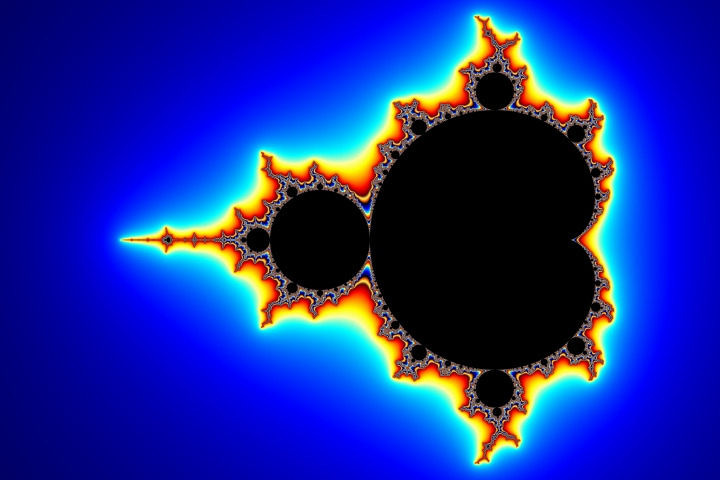

 

## Introduction

We will study several Mathematical Concepts and apply them to Art and
Design. Their methods will be examined and then coded in [p5.js](https://p5js.org/) to implement projects of interest. (We might on a later occasion try to use [q5.js](https://q5js.org/home/) /
[p5play.js](https://p5play.org/). Other open source tools
(FOSS) and Javascript libraries may also be introduced as and when
needed and as and when I learn and get excited about them. )

This course stands on "three legs": **Maths**, **Code + Tech**, and
**Artifacts**, as shown below. As this course grows and hopefully
becomes more un-popular ;-D, more and more of these modules below will
become reality!

| **Maths** | **Code + Tech** | **Artifacts** |
|:-------------------------:|:-------------------------:|:----------------:|
| Complex Numbers Euler's Formula Random Numbers Vector Algebra Iterated Functions Non-Euclidean Geometry | `p5.js` / `q5.js` / `p5play.js` Shapes Stack, Push and Pull, Translate Vectors Animation Recursion Constructors and OOP | Fractals L-Systems  Symmetries Textures Perlin Noise Friezes WallPaper Patterns Paper Clothing|
Graphs Networks Adjacency Matrices Voronoi Diagrams Knots Euler Paths Hamiltonian Paths  | Ditto  | South Indian Kolams Angolan Sona Patterns Rangoli Friendship Graphs  Illustrations|
| Linear Systems   Impulse Responses Convolution Electrical System Theory (poles; zeroes; resonance…)? DSP basics? AM/FM/PM Modulation? Fourier Series Bessel Functions? Waves; Echoes ? Non-linearities; Saturation; Hysteresis ? | Adding External Physics and Sound Libraries `p5.sound` `q5play` Camera, Sound and Mic Handphone based Interactions OSP Protocol based interactions with external hardware over WiFi / BT | Sound Video Text Crowd-Sourced acts Jam session  Flash-techno mob Mouse - Touchpad Orchestra |
| Neural Net Basics  Matrix Algebra Training Backpropagation Gradient Descent Classification, Regression, Clustering |  `ml5.js` libraries | Multi-Layer Perceptrons Convolutional Neural Networks Pose, Gesture, and Face Detection |
| Complexity and Emergent Phenomena? | Interfacing `p5.js` with Makey-Makey / Arduino / Raspberry Pi? Sensors Actuators | Games Public Space Installations Simulations Remote Education with Gesture tracking and live Coding? “Literary” Events with Tech? Working with other materials like sand, water, paper, wood, cloth, balloons ? “Action at a Distance” using say ~~quantum~~ ~~entanglement~~ [IFTTT](https://ifttt.com)? |
| I’ll | Be | Back |

: Math Experiments with Code

---

To get started, you can check out this course using the menu on the left.  Or click the button below:

[Start Here →](content/courses/MathArtDesign/Modules/05-Maths/listing.qmd){.btn .btn-primary .btn-xl role="button"}
\center

---

## Student Portfolios

My student portfolios are here:\

[Ananya Satish, Nishtha Raval](https://editor.p5js.org/nishtharaval1/full/JYltkiSNS);[Sneha Manu Jacob aka SMJ](https://editor.p5js.org/SnehaManuJacob/sketches/8RDpOGwbT); [Sara Saju](https://meucsara.netlify.app/); and [Diya Bijoy, Rayna Singh, Aanya Pandith, Naman Rajoria, Soumya Saboo.](https://naman-a2-mudra.netlify.app/posts/welcome/)\

and\

[We R Us: An R workshop](https://we-r-us.netlify.app/portfolio/);[Nikhita Purohit](https://nikhita-project-1.netlify.app/);[Diya Bijoy](https://diyadata.netlify.app/);[Rayna Singh](https://my-blog-rayna.netlify.app/);[Khushi Nagesh](https://khushinagesh.netlify.app/);\

## References

1.  [Course Abstract written by Arnold Schwarzenegger...](../../materials/pdfs/MathExperiments-Abstract.pdf)
1.  [What?? How?](https://californiaglobe.com/fr/the-story-of-arnold-schwarzeneggers-infamous-hidden-expletive-veto/)
1. p5.js Educational Resources. <https://beta.p5js.org/education-resources/>

### General

1.  Bret Victor. *Learnable Programming*.
    <https://worrydream.com/LearnableProgramming/>
2.  Michael Nielsen.(February 2016). *Toward an exploratory medium for
    mathematics*. <https://cognitivemedium.com/emm/emm.html>
3.  Rune Madsen. *Programming Design Systems*.
    <https://programmingdesignsystems.com>. A free digital book that
    teaches a practical introduction to the new foundations of graphic
    design.
4.  Colah's ( not [~~Kolha's~~🦊, you dear Marathi pests!](https://kolhapur.gov.in/en/about-district/) ) Blog.
    <https://colah.github.io/>

### p5.js, q5.js, q5play.js, and Processing

1.  Getting Started with p5.js
    <https://p5js.org/tutorials/setting-up-your-environment/>
1.  Coding Rainbow: Basic-est set of videos on p5.js
    <https://youtube.com/playlist?list=PLglp04UYZK_PrN6xWo_nJ-8kzyXDyFUwi&si=BWSDVX9-Bt85KXdO>
1.  Coding Train with Dan Shiffman:
    -   Website: <https://thecodingtrain.com/>
    -   Github: <https://github.com/CodingTrain/website-archive>
1.  p5.js Wiki. <https://github.com/processing/p5.js/wiki>
1.  p5.js at CodeAcademy <https://www.codecademy.com/learn/learn-p5js>
1.  p5.js at HappyCoding <https://happycoding.io/tutorials/p5js/>
1.  OpenProcessing <https://openprocessing.org>
1.  <https://www.codecademy.com/content-items/5e5c0d2a7b20535fbe8aed05e739e027>
1.  Older versions of p5.js <[`p5.js`](https://p5js.org/).>
1. q5.js Home <https://q5js.org/home/>
1.  q5play Game Engine <https://q5play.org/> q5play is for creating
    interactive art and games with the Box2D physics engine.

### Other Tools
1.  Making Explanations (tools): <https://explorabl.es/tools/>
1.  ***Using p5 in R***. Yeah.
    <https://alistaire.rbind.io/blog/p5-in-r/>
1.  createCanvas Podcast. <https://soundcloud.com/processingfoundation>
1.  <https://processingfoundation.org/education>
1.  <https://nannou.cc> Nannou is a library that aims to make it easy for artists to express themselves with simple, fast, reliable code.
1.  <https://openframeworks.cc/> openFrameworks is an open source C++ toolkit for creative coding.
1.  <https://libcinder.org> Cinder is a free and open source library for professional-quality creative coding in C++.
1.  *The Book of Shaders* by Patricio Gonzalez Vivo and Jen
    Lowe. <https://thebookofshaders.com/>
1.  Scott Murray's D3 Art page: <https://scottmurray.org/>
1.  Inigo Quilez, Digital Artist: <https://iquilezles.org/>
    (*ShaderToy*, *GraphToy*, and *MadeThisThing*)
1. Strudel: <https://strudel.org.uk/> Strudel is a free and open source creative coding environment for the web.
1. pD: <https://pdpatchrepo.info/> Pure Data is an open source visual programming language for multimedia.
5.  AI tools for Journalists. <https://journaliststoolbox.ai/> A vast
    list of tools for every purpose you can think of.

### R-language-related Resources

1.  Thomas Lin Pedersen:
    -   Website: <https://www.data-imaginist.com/art>
    -   Website: <https://ambient.data-imaginist.com/index.html> (R
        package `ambient`)
    -   Github:
2.  Antonio Sánchez Chinchón:
    -   Website: <https://fronkonstin.com>
    -   Github: <https://github.com/aschinchon/abstractions>
3.  Danielle Navarro's Generative Art:
    -   Website: <https://art-from-code.netlify.app>
    -   Github: <https://github.com/arvindvenkatadri/art-from-code>
        (forked by me)
    -   Website: <https://art-from-code.netlify.app>
4.  Claus Wilke:
    -   Website: <https://clauswilke.com/art/>
5.  Generative Art by Katharina Brunner:
    -   Github:<https://github.com/cutterkom/generativeart>
    -   Webpage:<https://katharinabrunner.de/generativeart/>
6.  William Chase:
    -   Website: <https://www.williamrchase.com/>
    -   Github: <https://github.com/will-r-chase>
    -   Blog Posts: <https://www.williamrchase.com/writing/>
        -   <https://buttondown.email/willchase/archive/the-generative-art-dataviz-spectrum/>
        -   <https://www.williamrchase.com/post/strange-attractors-12-months-of-art-february/>
        -   <https://www.williamrchase.com/writing/2019-09-30-flow-fields-12-months-of-art-september/>
        -   <https://www.williamrchase.com/writing/2019-08-30-12-months-of-art-august/>
        -   Poisson Disc sampling
            <https://www.williamrchase.com/writing/2019-07-29-textues-and-geometric-shapes-12-months-of-art-july/>
            and the `poissoned` R package by @coolbutuseless
7.  Marcus Volz:
    -   Website: <https://marcusvolz.com>
    -   Github: <https://github.com/marcusvolz>
8.  <https://generative.substack.com/p/generative-art-and-r>
9.  Generative Art.
    <https://paulvanderlaken.com/2020/05/02/generative-art-computer-design-painting/>
10. R-tistry with ggplot:
    <https://www.bigbookofr.com/art.html#thinking-outside-the-grid---a-bare-bones-intro-to-rtistry-concepts-in-r-using-ggplot>
11. <https://www.rforscience.com/scientific-computing.html>

### Deep Learning and AI

1.  *Practical Deep Learning for Coders*. <https://course.fast.ai/>
2.  Michael Nielsen.
    <http://neuralnetworksanddeeplearning.com/index.html>
3.  Ian Goodfellow and Yoshua Bengio and Aaron Courville. *Deep Learning
    Book*. <https://www.deeplearningbook.org/>
4.  *Dive into Deep Learning*. **Interactive** deep learning book with
    code, math, and discussions. Implemented with **PyTorch**,
    **NumPy/MXNet**, **JAX**, and **TensorFlow**Using Other Tools.
    <https://www.d2l.ai/index.html>
5.  Simon Scardapane. *Alice's Adventures in Differentiable Wonderland*.
    <https://www.sscardapane.it/assets/alice/Alice_book_volume_1.pdf>
6.  François Fleuret. *The Little Book of Deep Learning*.
    <https://fleuret.org/public/lbdl.pdf>
7.  Frank Rosenblatt. *Principles of Neurodynamics: Perceptrons and the
    Theory of Brain Mechanisms*.
    <https://gwern.net/doc/ai/nn/1962-rosenblatt-principlesofneurodynamics.pdf>
8.  Warren S. McCulloch, Walter Pitts (1943). *A Logical Calculus of the
    Ideas of Immanent in Nervous Activity*. BULLETIN OF MATHEMATICAL
    BIOPHYSICS VOLUME 5, 1943.
    \<[https://www.aemea.org/math/McCulloch_Pitts_1943.pdfhttps://www.aemea.org/math/McCulloch_Pitts_1943.pdf](https://www.aemea.org/math/McCulloch_Pitts_1943.pdf)

## Other Interesting Websites and Works

1.  <https://generatecoll.medium.com/how-i-used-excel-to-create-abstract-album-artwork-fee740d4414f>
1.  Random Digital Beauty. <https://anaselk.com/p/generative-r/>
1. Sophia Crespo: (makes speculative biological creatures using neural
    networks)
    -   Website: <https://sofiacrespo.com/>
    -   Website: <https://entangledothers.studio/>
    -   Github:
1. R for Scientific Visualization.
    <https://www.rforscience.com/visualisation.html>
1. R for Scientific Computing.
    <https://www.rforscience.com/scientific-computing.html>
4.  Reddit Generative Art Forum. <https://www.reddit.com/r/generative/>

## Creative Coding Courses Elsewhere

1.  Allison Parrish. <https://creative-coding.decontextualize.com>
2.  Matthew Bardin. <https://pdm.lsupathways.org>
3.  Tim Cortina at Carnegie Mellon Univ2.
    <https://www.cs.cmu.edu/~tcortina/15104-f20/lectures/>

## Learning Modules
